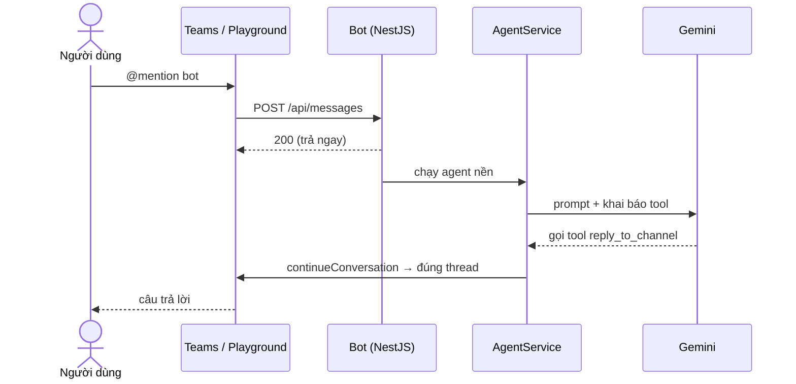

<div align="center">

# ms-teams-agent

**`@mention` bot trong Microsoft Teams → AI agent xử lý → trả lời đúng thread.**

[](https://nodejs.org)
[](https://nestjs.com)
[](https://www.typescriptlang.org)
[](https://aistudio.google.com)
[](https://learn.microsoft.com/microsoftteams/platform/bots/what-are-bots)

</div>

---

## Tính năng

| | |
|---|---|
| 💬 **Hỏi đáp trong channel** | `@mention` bot → AI (Gemini, có function calling) trả lời vào đúng thread |
| 🔧 **Tool mở rộng** | Mỗi tool một file, thêm tool mới không phải sửa code đang chạy |
| 📣 **API gửi tin chủ động** | `POST /api/notify` cho CI/CD, cron, service nội bộ bắn tin vào channel |
| 🖥️ **Trang quản trị** | Trạng thái bot, danh sách channel, soạn & gửi tin, nhật ký realtime |
| 🧪 **Test local trọn vẹn** | Dùng Agents Playground: không cần tenant M365, không cần ngrok |

## Bắt đầu nhanh

Yêu cầu: Node 22+.

```bash
npm install
cp .env.example .env     # để trống MicrosoftApp* → chạy chế độ ANONYMOUS
npm run start:dev        # http://localhost:3978
```

Mở terminal thứ hai để chat thử:

```bash
npm install -g @microsoft/m365agentsplayground
npm run playground       # mở http://localhost:56150 → Teams Channels
```

Gõ `@CMC Assistant xin chào`. Chưa có `GEMINI_API_KEY` thì bot chạy **ECHO mode** (nhại lại tin
nhắn), đủ để kiểm tra luồng Teams trước khi tốn token. Có key thì thử `@bot mấy giờ rồi?` hoặc
`@bot tính (12+8)*3`.

Test end-to-end không cần mở Playground:

```bash
npm run start:dev   # terminal 1
npm run test:e2e    # terminal 2: giả lập Teams gửi @mention, kiểm tra bot trả lời đúng thread
```

## Cách hoạt động



Bot trả `200` ngay rồi mới chạy agent ở nền, vì Teams sẽ gọi lại nếu webhook chậm.

<details>
<summary><b>Khác biệt giữa local và production</b></summary>

<br>

| | Local (Playground) | Production (Teams thật) |
|---|---|---|
| Đường vào | `localhost:3978/api/messages` | `https://<domain>/api/messages` qua Bot Framework Service |
| Xác thực | Không JWT (ANONYMOUS) | Verify JWT bằng `MicrosoftAppId/Password/TenantId`, sai trả `401` |
| Chiều trả lời | Gọi thẳng vào Playground | Xin access token rồi `POST {serviceUrl}/v3/conversations/{id}/activities` |
| Hạ tầng | Không cần | Domain public + TLS (Traefik) |

Checklist từ lúc code xong tới khi chạy trên Teams thật (tạo bot, lấy credentials, sideload
vào team, xin quyền IT, deploy) nằm ở **[DEPLOY.md](./DEPLOY.md)**.

</details>

## Cấu hình

Toàn bộ biến môi trường được đọc một lần ở [`src/config/config.ts`](./src/config/config.ts).

| Biến | Cần khi | Mô tả |
|---|---|---|
| `MicrosoftAppId` | Teams thật | Bot ID, từ Teams Developer Portal |
| `MicrosoftAppPassword` | Teams thật | Client secret của bot |
| `MicrosoftAppTenantId` | Teams thật | Tenant ID công ty |
| `GEMINI_API_KEY` | Muốn AI thật | Lấy tại [AI Studio](https://aistudio.google.com/apikey). Trống = ECHO mode |
| `GEMINI_MODEL` | | Mặc định `gemini-3.8-flash` |
| `GEMINI_BASE_URL` | Dùng proxy nội bộ | Mặc định endpoint của Google |
| `NOTIFY_API_KEY` | Production | Khoá cho `/api/notify` và `/api/admin/*` |
| `BOT_DISPLAY_NAME` | | Tên hiện trong trang quản trị, mặc định `CMC Assistant` |
| `CONVERSATION_STORE_FILE` | | Nơi lưu địa chỉ channel, mặc định `data/conversations.json` |
| `PORT` | | Mặc định `3978` |

> [!IMPORTANT]
> Để trống cả ba biến `MicrosoftApp*` thì bot chạy **ANONYMOUS**, chỉ dùng được với Playground.
> Nếu `NODE_ENV=production` mà thiếu `MicrosoftAppId`, server từ chối khởi động để không lỡ
> expose `/api/messages` ra internet mà không xác thực.

## API gửi tin vào Teams

Dành cho hệ thống khác chủ động bắn tin vào channel, không cần ai `@mention`. Bot phải đã được
cài vào team đó; lúc cài, bot tự lưu địa chỉ các channel của team.

```bash
# Bot gửi được vào những channel nào
curl -H "x-api-key: $NOTIFY_API_KEY" http://localhost:3978/api/notify/channels

# Tạo post mới (channel theo tên hoặc conversationId)
curl -X POST http://localhost:3978/api/notify \
  -H "Content-Type: application/json" -H "x-api-key: $NOTIFY_API_KEY" \
  -d '{"channel":"release","text":"🚀 Deploy **v1.2.0** thành công"}'
# → {"ok":true,"channel":"release","conversationId":"19:...","threadId":"1730000000000", ...}

# Reply vào thread vừa tạo
curl -X POST http://localhost:3978/api/notify \
  -H "Content-Type: application/json" -H "x-api-key: $NOTIFY_API_KEY" \
  -d '{"channel":"release","text":"Changelog: fix login","threadId":"1730000000000"}'
```

| Mã | Ý nghĩa |
|---|---|
| `400` | Thiếu `channel` hoặc `text` |
| `403` | Sai `x-api-key`, hoặc production chưa đặt `NOTIFY_API_KEY` |
| `404` | Bot chưa biết channel đó. Cài bot vào team, hoặc `@mention` bot trong channel một lần |

## Trang quản trị

Mở **http://localhost:3978/** để xem trạng thái bot, danh sách channel, soạn tin (có xem trước
giống Teams) và nhật ký hoạt động realtime. Nếu đã đặt `NOTIFY_API_KEY`, trang sẽ hỏi key và
lưu trong `localStorage` của trình duyệt.

## Thêm tool cho AI

Tạo một file trong [`src/agent/tools/`](./src/agent/tools) rồi thêm vào mảng `tools` ở
`src/agent/tools/index.ts`. Xem `get-current-time.tool.ts` làm mẫu ngắn nhất.

```ts
// src/agent/tools/get-build-status.tool.ts
import { AgentTool } from './tool.interface';

export const getBuildStatusTool: AgentTool<{ project: string }> = {
  definition: {
    name: 'get_build_status',
    description: 'Lấy trạng thái pipeline GitLab gần nhất của project',
    parameters: { type: 'object', properties: { project: { type: 'string' } }, required: ['project'] },
  },
  execute: async ({ project }) => (await fetch(`http://internal-api/builds/${project}`)).json(),
};
```

## Cấu trúc

Chia theo module NestJS, mỗi module một trách nhiệm.

```
src/
├─ main.ts                    Bootstrap; chặn production thiếu MicrosoftAppId
├─ app.module.ts              Chỉ ghép các module bên dưới
├─ config/                    Biến môi trường, đọc một lần, có kiểu
├─ common/                    CommonModule (@Global): ApiKeyGuard, EventLogService
├─ teams/                     Mọi thứ nói chuyện với Bot Framework
│  ├─ bot-framework.provider.ts       Factory tạo CloudAdapter
│  ├─ bot-activity.handler.ts         Lọc @mention, chạy agent nền
│  ├─ conversation-sender.service.ts  Gửi tin chủ động (dùng cho reply và notify)
│  ├─ teams-installation.service.ts   Ghi nhớ conversation khi bot được cài
│  └─ conversation-store.service.ts   Lưu địa chỉ channel (file JSON)
├─ agent/                     Vòng lặp AI, độc lập với Teams
│  ├─ agent.service.ts                Gemini function calling, lịch sử theo thread
│  ├─ tool-registry.service.ts        Tra và chạy tool theo tên
│  └─ tools/                          Mỗi tool một file
├─ notify/                    POST /api/notify, GET /api/notify/channels
└─ admin/                     Trang quản trị + API trạng thái/nhật ký
```

Ngoài `src/`: [`public/index.html`](./public/index.html) (giao diện quản trị, không build step),
[`scripts/smoke-test.ts`](./scripts/smoke-test.ts) (e2e), `.m365agentsplayground.yml` (dữ liệu
giả cho Playground), [`DEPLOY.md`](./DEPLOY.md).

## Trước khi lên production

- [ ] Lịch sử hội thoại và conversation store đang nằm trong bộ nhớ / file JSON. Chạy nhiều
      replica thì chuyển sang Redis hoặc DB.
- [ ] `runAgent` chạy kiểu fire-and-forget (`void`). Nên đưa vào hàng đợi (BullMQ) để không mất
      job khi container restart giữa chừng.
- [ ] Chỉ expose `/api/messages` ra internet qua Traefik. `/api/notify` và `/api/admin/*` chỉ
      nên ở mạng nội bộ, hoặc thêm một lớp xác thực khác nếu phải expose.
- [ ] Đặt `NOTIFY_API_KEY` đủ dài (`openssl rand -hex 32`), lưu trong CI variables (masked),
      không hard-code trong repo.
